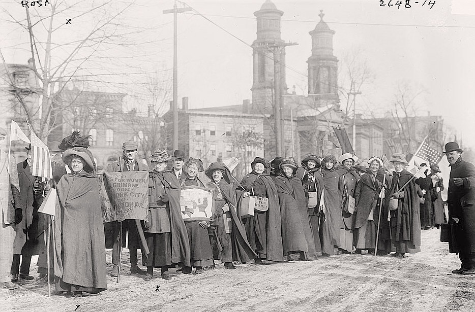
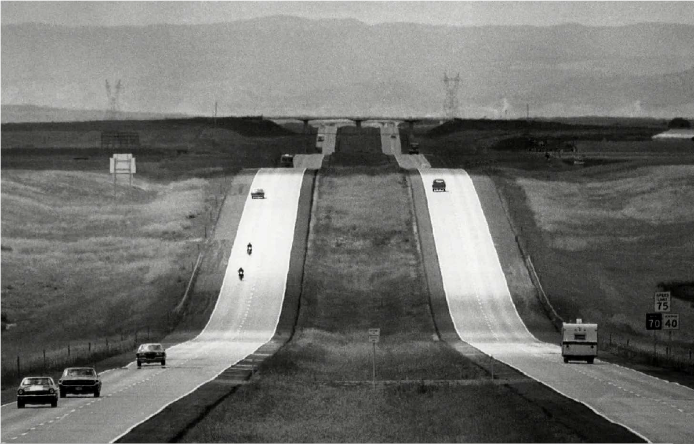
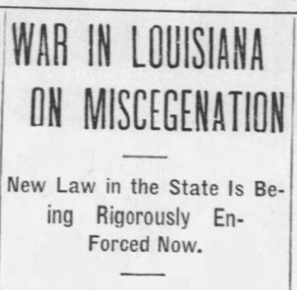
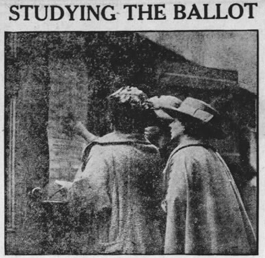
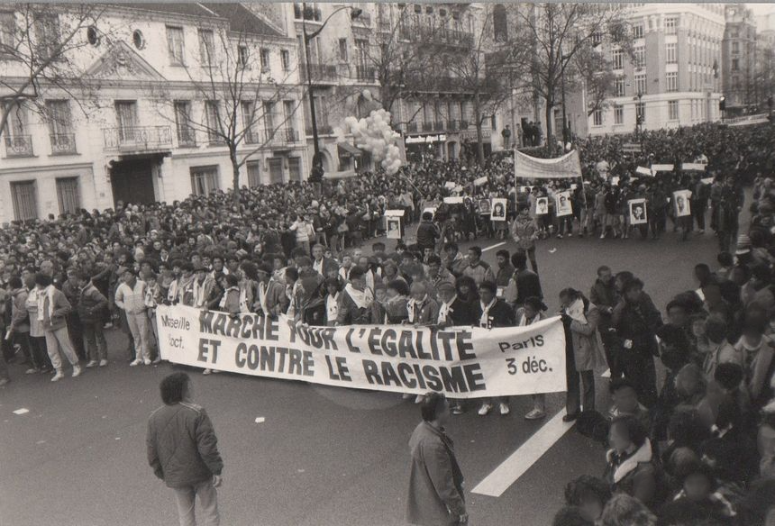
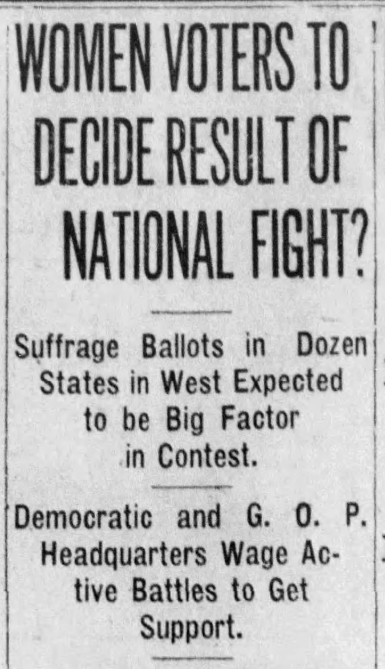

My research lies at the intersection of economic history, political economy, and urban economics. I explore three main themes: (i) the effects of collective action on social roles and political behavior; (ii) the diffusion of political participation and the consequences of expanding voting rights; and (iii) the role of institutions and infrastructure in shaping economic inequalities and individual trajectories. Across these themes, my work places particular emphasis on gender and historically marginalized groups.

<!-- ===================== WORKING PAPER ===================== -->
<h4 class="section">Working Paper</h4>

<!-- Projet 1 -->

  

  <h5 style="margin: 0 0 5px 0;"><strong>**Women's Political Mobilization and Gender Roles**</strong></h5>
  
Runner-up for the <a href="https://urbaneconomics.org/meetings/awards.html" target="_blank" rel="noopener">EMUEA 2024 Best Student Paper</a>

  <button class="rbtn" onclick="window.open('https://hal.science/hal-05868059', '_blank')">
      Working paper
  </button>
  <button class="rbtn" onclick="toggleContent('abstract1')">
      Abstract
  </button>

  

      
 Abstract: Can exposure to women's political mobilization during formative years shape gender roles? I study the causal impact of a march organized in 1913  between Newark and Washington, DC, to advocate for women's suffrage, which highly increased women's political visibility in towns along its route. I combine newly digitized data on the march itinerary with newspaper archives and linked census records. Comparing over time towns along the route to comparable towns along a nearby major road, I implement an event-study and a triple-difference design. Newspaper evidence indicates that the march led to a sustained increase in the local visibility of women in public life, beyond the one-time demonstration. Consistent with this, although gender roles were already evolving, exposure to the march--and to the sustained increase in women's political participation--appears to have accelerated this transformation. Women exposed during formative years are more likely to report being ``gainfully employed," delay marriage, and postpone fertility. 

  

<!-- ===================== WORK IN PROGRESS ===================== -->
<h4 class="section" style="margin-top: 40px;">Work in Progress</h4>

<!-- Projet 2 -->

  

  <h5 style="margin: 0 0 5px 0;"><strong>**Roads, Employment and Education: Evidence from the US Rural Highways**</strong></h5>
  
With <a href="https://sites.google.com/site/clementbosquet/">C. Bosquet</a> [draft upon request]

  <button class="rbtn" onclick="toggleContent('abstract2')">
      Abstract
  </button>

  

      
 Abstract: We study the employment responses of teenagers to changes in local economic opportunities induced by improvements in transport infrastructure, and the potential consequences for education and longer-term life trajectories. We exploit the timeline of US highway construction in the mid-20th century and combine US Census data from 1940 to 1980 with historical records on highway locations and opening times. Employing an established instrumental variable to account for the non-random placement of highways combined with a difference-in-differences strategy, we find that road connectivity increases participation in the labor market. This effect is primarily driven by teenage boys starting to work as (unpaid family) farm laborers in the agricultural sector, whose employment share has declined at a slower rate in connected counties. Finally, although evidence suggests no significant short-term impact on educational enrollment, further investigation indicates that the employment effects of early connection to the highway network persist into adulthood and are associated with a lower level of welfare.

  

<!-- Projet 3 -->

  

  <h5 style="margin: 0 0 5px 0;"><strong>**Forbidden Love: The Impact of Banning Interracial Marriages**</strong></h5>
  
With <a href="https://sites.google.com/view/bjoernbrey/home">B. Brey</a> and <a href="https://sites.google.com/site/rziparo/">R. Ziparo</a> [draft upon request]

  <button class="rbtn" onclick="toggleContent('abstract3')">
      Abstract
  </button>

  

      
 Abstract: Following the Civil War, miscegenation laws were introduced across the United States. These laws declared interracial marriages "prohibited and void," making them a cornerstone policy of segregation. According to Cox (1960), the primary motive behind the adoption of these laws was to prevent Black Americans from climbing the social ladder. Thus, by exploiting the staggered adoption of these laws across states, we test the hypothesis that their adoption contributed to maintaining the economic disparities between racial groups, inherited from slavery. To do so, we combine information on state-level miscegenation laws with individual data from the US censuses (1870-1940) and implement a generalized difference-in-differences strategy. Our results indicate that the laws increased the probability of Black Americans being employed as farmworkers by approximately 3%, and decreased the likelihood of being farm managers by 53%. These findings suggest that the implementation of miscegenation laws contributed to maintaining an exploitative agricultural system. Our results are robust to testing for pre-trends and implementing advanced staggered difference-in-differences techniques.

  

<!-- Projet 4 -->

  

  <h5 style="margin: 0 0 5px 0;"><strong>**Network Effects in Women's Political Participation**</strong></h5>
  
With <a href="https://vincentbagilet.github.io/">V. Bagilet</a> [draft upon request]

  <button class="rbtn" onclick="toggleContent('abstract4')">
      Abstract
  </button>

  

      
 Abstract: To what extent does horizontal norm transmission shape women's voting culture? This paper examines how exposure to neighbors with entrenched voting norms can influence the likelihood of registering to vote. To quantify potential network effects, we focus on women neighbors who migrated to Boston from U.S. states where women had been enfranchised prior to 1920, the year women gained the right to vote nationwide. Using precise residential addresses, we reconstruct fine-grained neighborhood communities and local social networks. We then aim to study the impact of exposure to women from early-suffrage states on both the behavior and normative beliefs of their women neighbors, exploiting idiosyncratic variation at the block level: while households may select their neighborhood, the specific block of residence is largely determined by quasi-random factors. Preliminary evidence suggests that women living near migrants from early-suffrage states were more likely to register to vote.

  

<!-- Projet 5 : Marche de 1983 -->

  

  <h5 style="margin: 0 0 5px 0;"><strong>**Here to Stay: Second-Generation Mobilization and Anti-Immigration Voting**</strong></h5>
  
With <a href="https://camiloumanadajud.com/">C. Umana Dajud</a> and <a href="https://sites.google.com/view/valettejerome/home">J. Valette</a>

  <button class="rbtn" onclick="toggleContent('abstract5')">
      Abstract
  </button>

  

      
 Abstract: This paper studies how natives respond when second-generation immigrants mobilize and become politically salient, using geographic variation in exposure to France's 1983 March for Equality and Against Racism, the first nationwide protest led by the children of postcolonial immigrants. Relying on archival sources, we reconstruct the march's most likely route and combine it with municipal returns from legislative elections between 1967 and 2012. A difference-in-differences design then compares the evolution of vote shares in municipalities closer to the announced route with that in nearby municipalities farther from it. The results show a persistent backlash. After 1983, municipalities nearer the route experienced a 1.9-percentage-point increase in the vote share of anti-immigration right-wing candidates, mostly at the expense of the incumbent Socialist left, and this effect remained detectable for nearly fifteen years. Additional placebo tests and an instrumental-variables strategy based on deviations between the announced and documented routes support the causal interpretation of the estimates. Exploiting rainfall at the estimated time of passage, we also find a stronger backlash when rain likely limited opportunities for direct contact, suggesting that contact attenuated the threat response.

  

<!-- Projet 6 : When women vote -->

  

  <h5 style="margin: 0 0 5px 0;"><strong>**When Women Vote: Political Platforms and the Expansion of Suffrage in the United States**</strong></h5>
  
With <a href="https://maximechabriel.github.io/">M. Chabriel</a> and <a href="https://sites.google.com/site/sophiehatte/">S. Hatte</a>

